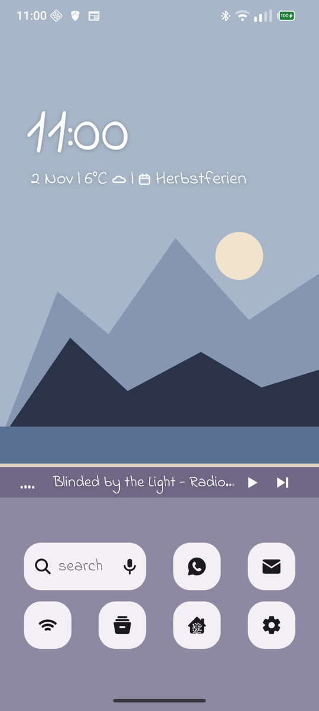
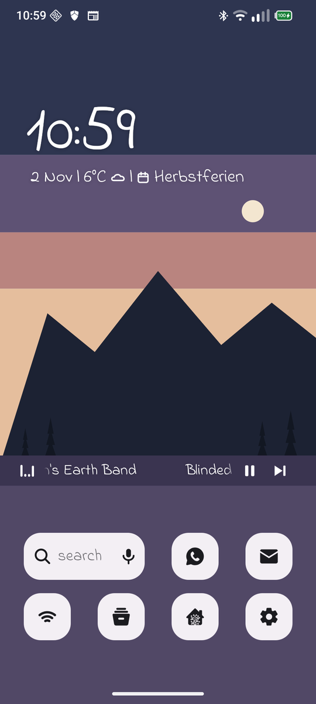
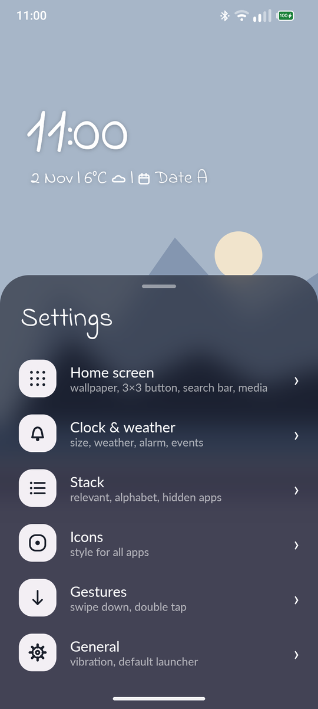

# Fjell

A calm Android launcher. Most of the screen goes to the landscape: the time in hand lettering,
your few everyday apps in the quiet band at the bottom, and everything else in a tidy stack one
swipe away.

<p align="center">
  
  
  
</p>

**[Download the latest APK](https://github.com/K0RBI02/Fjell/releases/latest)** · Android 10 or newer

For automatic updates, add Fjell to [Obtainium](https://github.com/ImranR98/Obtainium):
**[Add to Obtainium](https://apps.obtainium.imranr.dev/redirect?r=obtainium://add/https://github.com/K0RBI02/Fjell)**
(or paste `https://github.com/K0RBI02/Fjell` into *Add App*).

## Features

- **Home:** hand-lettered clock with date, weather, the next alarm or calendar event, and a
  now-playing line with a little music wave
- **Grid:** up to 4 × 3 apps or a search bar, placed by drag and drop, with a hairline arc for new
  notifications
- **Stack:** every other app A–Z, with letter headers, an alphabet strip and a row of relevant apps
  (just installed, then most used)
- **Search:** apps first, then quick calculations, contacts with a call button, and the web
- **Icons:** any icon pack, grayscale, simple or your own pictures, globally or per app
- **Scenes:** three flat landscapes drawn in code, or your own pictures; a timetable can switch
  them by the clock or by sunrise and sunset
- **Gestures:** swipe down for notifications, double tap to lock, hold for settings

## Building

You need JDK 21+ and the Android SDK with platform 37.2.

```sh
./gradlew assembleRelease          # app/build/outputs/apk/release/app-release.apk
./gradlew ktlintCheck lintRelease  # style and lint
./gradlew verifyRoborazziDebug     # unit and screenshot tests
```

Without a release key the build is signed with the debug key. To sign with your own, set
`FJELL_KEYSTORE`, `FJELL_KEYSTORE_PASSWORD`, `FJELL_KEY_ALIAS` and `FJELL_KEY_PASSWORD` as
environment variables or in `~/.gradle/gradle.properties`. `git config core.hooksPath .githooks`
runs ktlint before each commit.

## License

Fjell is free software under the [GNU GPL v3 or later](LICENSE); see [NOTICE](NOTICE). Fonts are
listed in [licenses/README.md](licenses/README.md).
